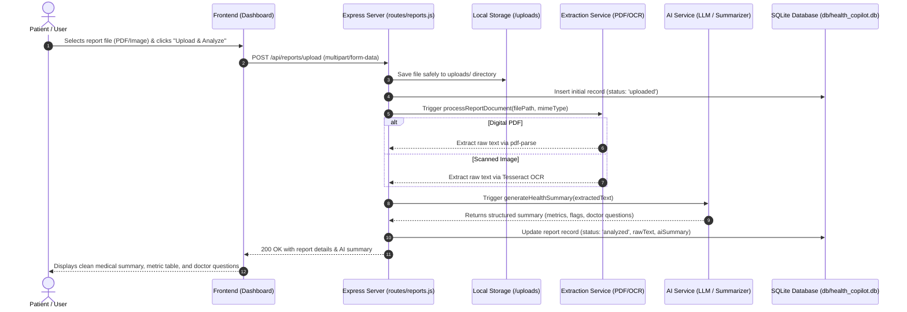

# Health Copilot — System Architecture & Data Flow

This document details the architectural layout, technical components, and end-to-end data pipeline for **Health Copilot**.

---

## 1. High-Level Pipeline Flow

```
Frontend (UI)
     │
     ▼ [1. Multipart Upload: PDF/Image]
Backend (Express API)
     │
     ▼ [2. Send File Path & MIME Type]
Extraction Service (PDF-Parse / Tesseract OCR)
     │
     ▼ [3. Sanitized Raw Text]
AI Summarization Service (LLM / Local Model)
     │
     ▼ [4. Structured Metrics & Patient Summary]
Database Layer (SQLite)
     │
     ▼ [5. JSON Payload with Analysis & Findings]
Frontend (UI Dashboard Rendering)
```

---

## 2. Sequence Diagram



---

## 3. Core Component Responsibilities

### 3.1 Frontend (`/frontend`)
- **Technology:** Semantic HTML5, Vanilla CSS, Bootstrap 5, JavaScript.
- **Role:** 
  - Drag-and-drop document upload interface.
  - Client-side validation (file size under 10MB, allowed MIME types).
  - Backend connectivity health monitoring.
  - Accessible, responsive medical dashboard displaying:
    - Overview summary in simple, patient-friendly terms.
    - Extracted lab metrics (values, reference ranges, abnormality indicators).
    - Suggested questions to ask a doctor.

### 3.2 Backend Server (`/backend/server.js` & `/backend/routes`)
- **Technology:** Node.js, Express, Multer, CORS.
- **Role:**
  - Serves as the central orchestrator and REST API.
  - Implements route protection, input sanitization, and file size limits.
  - Coordinates asynchronous processing between extraction, AI, and storage.

### 3.3 Text Extraction & OCR Service (`/backend/services/extraction.js`)
- **Technology:** `pdf-parse` (digital PDFs), `tesseract.js` (scanned images & photos).
- **Role:**
  - Ingests files stored in `/backend/uploads`.
  - Converts unstructured documents into clean text strings suitable for LLM context windows.
  - Strips unnecessary headers, artifacts, or redundant whitespace.

### 3.4 AI Summarization Service (`/backend/services/ai.js`)
- **Technology:** Free/Local Model (e.g. Ollama Llama 3 / Mistral) or free-tier API (e.g. Gemini Flash).
- **Role:**
  - Applies a strict system prompt emphasizing patient accessibility and non-diagnostic safety.
  - Extracts key metrics into structured JSON (test name, value, unit, reference range).
  - Flags values outside normal laboratory reference ranges.
  - Generates recommended questions for doctor consultations.
  - Embeds mandatory non-diagnostic disclaimers into every response.

### 3.5 Database Layer (`/backend/db/database.js`)
- **Technology:** SQLite (`sqlite3` / `better-sqlite3`).
- **Role:**
  - Zero-configuration, file-based relational store (`backend/db/health_copilot.db`).
  - Persists report upload records, processing status, extracted text, and AI responses.
  - Preserves user history across sessions while keeping all data locally stored.

---

## 4. Privacy, Security & Hackathon Safety

1. **Local-First Data Storage:** All medical reports and SQLite records remain on the user's local machine by default. No public cloud storage buckets are used.
2. **Git Safeguards:** Both `backend/uploads/*` and `backend/db/*.db` are excluded in `.gitignore` to prevent committing personal documents or data files to version control.
3. **Synthetic / Sample Data Only:** During hackathon demos, only synthetic lab reports or de-identified public test data must be used.
4. **Mandatory Disclaimer:** Health Copilot is an organizational and educational tool, not a certified medical device. It does not provide medical diagnoses or treatment advice.
